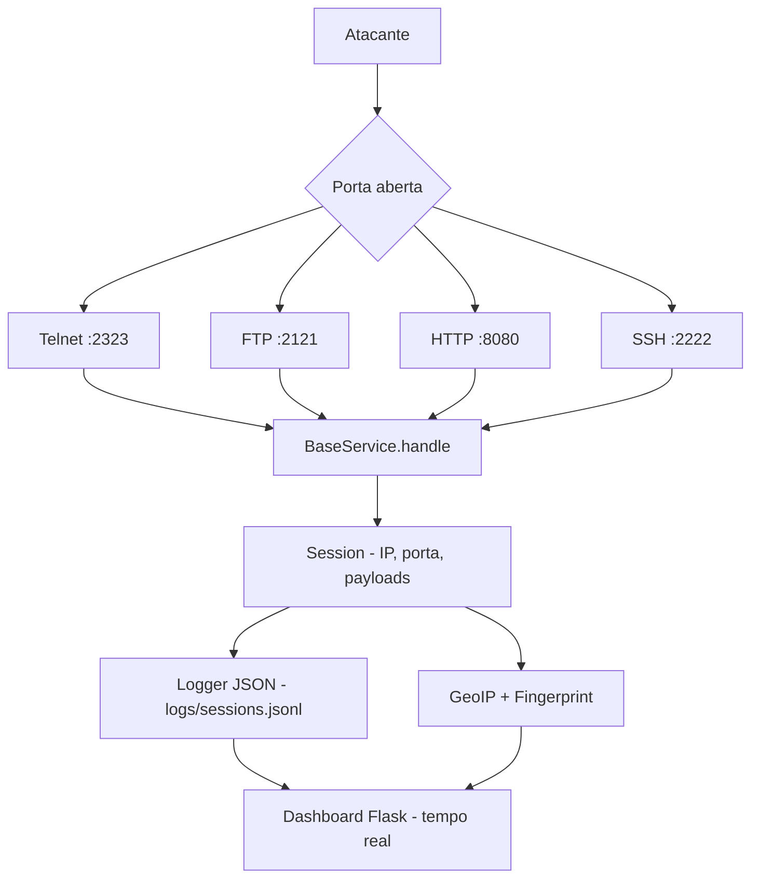

# Arquitetura — py-honeypot

## Visão geral

O py-honeypot é um **honeypot de baixa interação**: cada serviço exposto é uma
simulação mínima — o suficiente para manter o atacante engajado e capturar o
máximo de informação — sem expor código real vulnerável.



## Componentes

| Componente | Arquivo | Responsabilidade |
|------------|---------|------------------|
| Servidor | `honeypot/core/server.py` | Escuta portas, aceita conexões, cria threads |
| Sessão | `honeypot/core/session.py` | Estado de cada atacante (IP, porta, comandos, payloads) |
| Configuração | `honeypot/core/config.py` | Carrega e valida `config/config.yaml` |
| Logger | `honeypot/core/logger.py` | Log estruturado JSON com rotação |
| Serviço base | `honeypot/services/base_service.py` | Interface comum a todos os serviços falsos |
| Telnet | `honeypot/services/telnet.py` | Prompt de login falso, captura credenciais |
| FTP | `honeypot/services/ftp.py` | Banner FTP, captura USER/PASS |
| HTTP | `honeypot/services/http.py` | Página falsa, captura requests completos |
| SSH | `honeypot/services/ssh.py` | Banner SSH, handshake lento |
| GeoIP | `honeypot/utils/geoip.py` | País/cidade do IP do atacante |
| Fingerprint | `honeypot/utils/fingerprint.py` | Detecta scanners e padrões conhecidos |
| Dashboard | `dashboard/app.py` | Visualização em tempo real |

## Ciclo de vida de uma conexão

1. `server.py` escuta nas portas configuradas (uma thread por porta).
2. Conexão chega → `socket.accept()` → cria objeto `Session`.
3. `BaseService.handle()` envia o banner falso e lê dados do atacante.
4. Cada byte/comando recebido é registrado na sessão.
5. Ao encerrar (timeout ou desconexão), a sessão é serializada em JSON
   para `logs/sessions.jsonl`.
6. O dashboard lê o arquivo (ou recebe eventos) e exibe estatísticas.

## Extensão: novo serviço falso

Crie um arquivo herdando `BaseService`:

```python
# honeypot/services/smtp.py
from honeypot.services.base_service import BaseService

class SMTPFake(BaseService):
    name = "smtp"

    async def handle(self, session, reader, writer):
        writer.write(b"220 mail.example.com ESMTP\r\n")
        await writer.drain()
        # ... ler comandos HELO/MAIL/RCPT e registrar em session
```

Depois registre-o em `config.yaml`. Nenhuma alteração no core é necessária.

## Decisões de design

- **Threads por conexão** (via `asyncio` ou `socketserver.ThreadingTCPServer`):
  simples e suficiente para volume de honeypot caseiro.
- **Logs em JSONL**: uma linha JSON por evento — fácil de ingerir em `jq`,
  pandas, ELK ou SQLite.
- **Portas altas por padrão** (> 1024): evita rodar como root, reduz risco.
- **Dashboard bind em 127.0.0.1**: o painel nunca fica exposto à internet.
